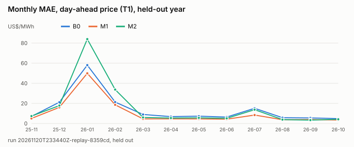
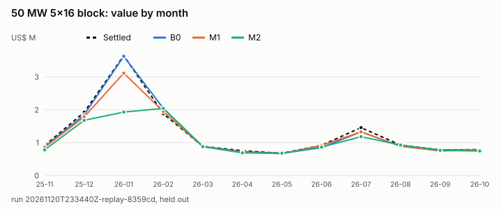

# power-markets

_Français d'abord, la référence ; [English below](#english)._

Construit avec Claude Code sous ma direction.

Le marché de l'électricité, une pièce à la fois. Chaque pièce a son dossier sous `pieces/` ; le code partagé vit
dans un seul paquet, `packages/pmcore`.

**Première pièce : le prix à la frontière** (`pieces/hq-price`). Prévoir et valider le prix horaire du marché du
jour précédent (day-ahead) et du temps réel à la zone que l'opérateur du réseau de New York (NYISO) nomme « H Q », et la
composante de congestion de chacun, sous une discipline sans anticipation :

- chaque prévision a une heure de décision tirée des documents de l'opérateur, cités ([problème](docs/problem.md)) ;
- un fichier n'est admis que si son heure d'archivage précède l'heure de décision d'au moins 60 minutes ;
- le [plan](docs/plan.md), avec chaque modèle évalué et la règle qui décide « meilleur », est figé par l'étiquette
  `plan-v1` (dans l'historique de travail privé, voir Provenance) avant tout rejeu de l'année réservée (hors
  échantillon) ; le résultat inscrit est celui du premier rejeu, et un second rejeu, permis par le propriétaire
  comme écart au plan, est montré à côté ;
- une référence naïve et des modèles concurrents ; un moniteur qui dit quand cesser de faire confiance à la
  prévision, avec ce qu'il peut ne pas détecter ; le revenu du lendemain d'un bloc 5×16 énoncé ;
- aucune ligne de profit : rien dans les règles de l'opérateur lues ne montre qu'on puisse prendre la position à
  cet endroit. « Pas d'avantage » est un résultat permis.

Le rapport : [français](docs/report/report.fr.md), [anglais](docs/report/report.en.md). Chaque chiffre vient d'une
exécution consignée dans `runs/`. En bref : sur l'année réservée (novembre 2025 à octobre 2026), 3 paires
modèle-cible sur 10 battent leur référence ; aucun modèle ne bat la prévision zéro de la congestion. 19 jours de
juillet 2026 manquent à l'archive du temps réel, et une nouvelle ligne Québec–New York (CHPE) est entrée en service
pendant l'année : voir les limites du rapport.

### En un coup d'œil

Chaque graphique est tracé à partir de l'enregistrement du rejeu de l'année réservée qu'il nomme
(`uv run hq-price figures --replay-run <id>`), jamais à partir de chiffres tapés. Seules des statistiques dérivées
sont tracées ; aucune série horaire de prix n'est publiée.


L'erreur de M1 est sous celle de la référence B0 chaque mois ; M2 décroche en janvier et février 2026.


Les arrêts de juillet sur T3 et T4 sont des jours où des prix en temps réel manquaient à la source, pas une dérive
des modèles.


**Projet frère** : [valiwatt](https://github.com/MrRolie/valiwatt) valide et surveille une prévision de la demande
horaire d'électricité du Québec, le côté de la demande ; ce dépôt couvre le côté du marché.

## English

Built with Claude Code under my direction.

The electricity market, one piece at a time. Each piece has its folder under `pieces/`; shared code lives in one
package, `packages/pmcore`.

**First piece: the price at the border** (`pieces/hq-price`). Forecast and validate the hourly day-ahead and
real-time price at the zone New York's grid operator (NYISO) names "H Q", and the congestion component of each,
under a no-lookahead discipline:

- each forecast has a decision time taken from the operator's documents, cited ([problem](docs/problem.md));
- a file is admitted only if its archive stamp is at least 60 minutes before the decision time;
- the [plan](docs/plan.md), with every model scored and the rule that decides "better", is frozen by the tag
  `plan-v1` (in the private working history, see Provenance) before any replay of the held-out year; the result
  of record is the first replay, and a second replay, allowed by the owner as a departure from the plan, is shown
  beside it;
- a naive baseline and competing models; a monitor that says when to stop trusting the forecast, with what it can
  miss; the next-day revenue of a stated 5×16 block;
- no profit line: nothing in the operator's rules read shows the position can be taken at that location. "No
  edge" is a legal result.

The report: [French](docs/report/report.fr.md), [English](docs/report/report.en.md). Every number comes from a
run recorded in `runs/`. In short: on the held-out year (November 2025 to October 2026), 3 of 10 model-target
pairs beat their baseline; no model beats the zero forecast of congestion. 19 days of July 2026 are missing from the
real-time archive, and a new Québec–New York line (CHPE) entered service during the year: see the report's limits.

### At a glance

Each chart is drawn from the held-out replay record it names (`uv run hq-price figures --replay-run <id>`), never
from typed numbers. Only derived statistics are drawn; no hourly price series is published.



M1's error is below the B0 baseline's in every month; M2 breaks away in January and February 2026.


The July stops on T3 and T4 are days when real-time prices were missing at the source, not model drift.



**Sibling project**: [valiwatt](https://github.com/MrRolie/valiwatt) validates and monitors a forecast of Québec's
hourly electricity demand, the demand side; this repository covers the market side.

### Run it

Python 3.12 and [uv](https://docs.astral.sh/uv/). Every command prints one JSON document.

```sh
uv sync --all-packages
uv run hq-price fetch --product damlbmp --start 2016-01 --end 2025-10   # also rtlbmp, isolf; refuses the held-out year
uv run hq-price validate                                                # walk-forward validation, writes runs/<id>.json
uv run hq-price rehearse --prior-run <validate id>                      # the replay's code path on the last validation year
uv run hq-price replay --prior-run <validate id>                        # once: tag check, ledger, held-out fetch, scores
uv run hq-price derive --from-run <validation id>   # robustness and outcome counts from the saved validation forecasts
uv run hq-price figures --replay-run <id>                              # the README's charts
uv run hq-price report --validate-run <id> --derived-run <id> --rehearse-run <id> --replay-run <id>
uv run pytest
```

### Data

NYISO's public files (`mis.nyiso.com/public`), downloaded by the fetch command into `data/raw/`, never committed
and never redistributed. Terms read and recorded in [docs/data-licences.md](docs/data-licences.md).

## Provenance / Provenance

Ce dépôt public est une copie à historique neuf d'un dépôt de travail privé. Les enregistrements de `runs/` et
`docs/replay-ledger.json` citent des commits de cet historique privé : l'étiquette du plan `plan-v1` est le
commit `9fc23ff`, et cette copie a été prise au commit `afe73b0`. L'historique privé peut être montré sur demande ;
sans lui, l'ordre « plan figé, puis rejeu » repose sur ces enregistrements et sur la confiance. Les données brutes
de NYISO ne sont pas redistribuées : `uv run hq-price fetch` les télécharge.

This public repository is a fresh-history copy of a private working repository. The records in `runs/` and
`docs/replay-ledger.json` cite commits of that private history: the plan tag `plan-v1` is commit `9fc23ff`, and
this copy was taken at commit `afe73b0`. The private history can be shown on request; without it, the order "plan
frozen, then replay" rests on these records and on trust. NYISO's raw data is not redistributed:
`uv run hq-price fetch` downloads it.
